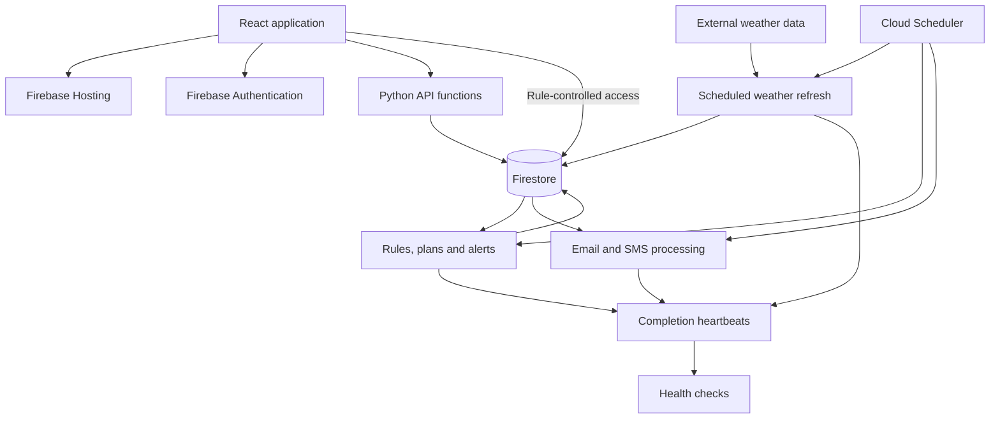

# TurfTrigger: operating a weather-driven application

[← Portfolio](../README.md) · [Application](https://turftrigger.com)

TurfTrigger is my personal lawn-care application. It converts weather data and
regional rules into timing guidance, plans, and email/SMS workflows. This case
study focuses on the operational design behind those features.

**Stack:** React, Vite, Python, Firebase Hosting, Firebase Authentication,
Firestore, Google Cloud Functions, Cloud Run, Cloud Scheduler, GitHub Actions.

## Architecture



The frontend presents decisions and records user actions. Python services own
the decision rules and scheduled processing. Plans and alerts share rule
functions, with replay checks to detect disagreement between surfaces.

## Incident: a scheduled job ran twice

On November 5, 2026, the project incident record documented a connection failure
during a cold start. The scheduler transport resent the request, and two
window-alert sweeps ran 23 seconds apart. Nothing was due that day, so this was
a discovered duplicate-delivery risk rather than a confirmed duplicate-email
incident.

The vulnerable sequence was simple: read delivery state, send a message, then
record completion. Two sweeps could both read the old state before either wrote
the new state. Disabling configured retries did not eliminate the duplicate
invocation observed here.

### Fix

The sweep now claims a document keyed by job and time slot before starting work.
An atomic create allows one invocation to win. A duplicate returns a successful
skip. If the winning sweep raises an exception, it attempts to release the claim
so a subsequent invocation can retry.

Simplified excerpt of the implemented control flow:

```python
def run_once_for_slot(claim, sweep):
    try:
        claim.create()             # Atomic: fails if already claimed.
    except AlreadyExists:
        return {"skipped": "duplicate_run"}, 200

    try:
        return sweep()
    except Exception:
        try:
            claim.delete()         # Allow a retry after a raised failure.
        except Exception:
            log_claim_release_failure()
        raise
```

This excerpt omits the storage adapter, metadata, and logging implementation.
The application implementation is `ops.once_per_slot`.

### Verification and limits

The focused regression suite passed on November 6, 2026. It checks that:

- A second invocation in the same slot skips without running the sweep.
- A different job or slot can run independently.
- A raised failure releases the claim and permits a retry.

These are in-memory regression tests, not a distributed load test. The claim
protects sweep execution; it does not establish exactly-once delivery by an
external email service. A hard termination can leave a claim behind, and a
failure after partial delivery still requires attention to recipient-level
delivery state.

**Operational lesson:** Design for duplicate invocations, distinguish execution
from external side effects, and document how to recover from partial failures.

## Monitoring: detecting missing work

Error logs cannot report a job that never starts. TurfTrigger's scheduled stages
record a heartbeat after successful completion. Health checks look for missing
or stale heartbeats, with thresholds based on the expected cadence.

The heartbeat also includes the release identifier read from the running
revision's environment. This helps distinguish a fresh result produced by stale
code from one produced by the intended release.

The design separates three questions:

1. Was a deployment requested?
2. Is the expected revision running?
3. Did the expected work complete successfully?

## Change management: verify the deployed result

The project contains a shared preflight script, CI workflows, and post-deploy
verification. Checks include container-image module completeness, application
builds, Python suites, security-rule tests, and customer replay grading.

Post-deploy verification checks runtime release identifiers and active revision
state. For a shared hosted data asset, it compares the served bytes with the
release commit. This catches a failure that a status-code check can miss: a
single-page application fallback can return HTTP 200 and HTML for a missing
JSON asset.

The deployment marker advances only after verification succeeds, so later
change detection does not treat an unverified release as the deployed baseline.

## Access boundaries and recovery

Firestore rules distinguish public read-only data, owner-scoped account data,
administrative access, and server-only records. Sensitive control fields are
protected even when other fields on the same user record are writable.

For example, clients cannot rewrite the state that tracks SMS check-ins or
one-time welcome delivery. These restrictions are enforced at the data layer,
with emulator-based security-rule tests in CI.

The project also documents backup jobs and recovery dependencies, including
configuration that cannot be reconstructed from source alone. A complete
end-to-end restore exercise remains outstanding. Recovery time and recovery
completeness therefore remain unmeasured, rather than assumed from the
existence of backups.

## Testing a workflow through time

Historical-weather replay exercises the decision engine across a full season.
A separate customer replay drives production processing entry points through
injected providers and captures messages and simulated user actions. It can
distinguish an alert being generated from its instructions being delivered.

The offline release gate uses committed weather fixtures to check for problems
such as missing instructions, contradictory messages, and repeated application
advice. Simulation results have explicit limits: hindsight weather differs from
an issued forecast, and internal consistency does not prove field accuracy.

## Evidence behind this case study

This write-up was checked against the application source at revision `725b6b8`.
Source modules include `ops.py`, `test_run_lease.py`, `canary.py`,
`verify_deploy.py`, `firestore.rules`, `customer_replay.py`, and `replay_grade.py`.
The duplicate-run fix is recorded in commit `4d8a55d`.

These identifiers provide provenance for a technical walkthrough. This
portfolio contains a curated explanation and a simplified excerpt; it does not
require access to the application's source repository.
