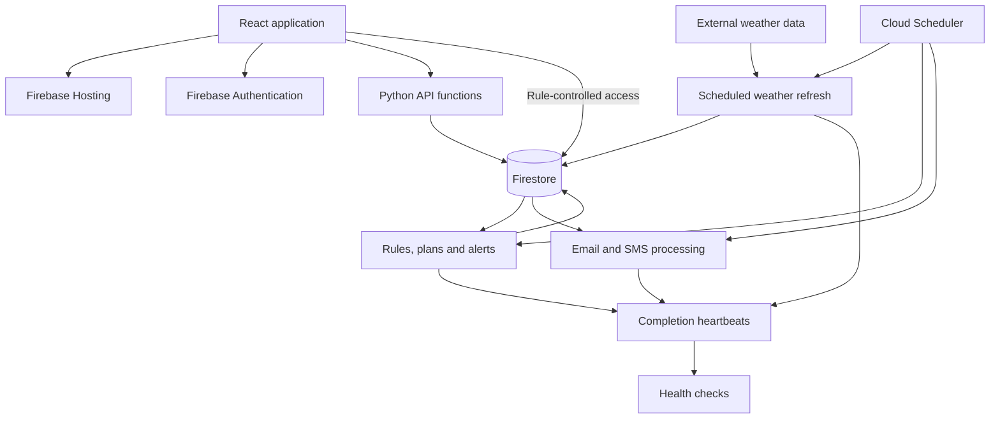

# TurfTrigger: operating a weather-driven application

[← Portfolio](../README.md) · [Application](https://turftrigger.com)

TurfTrigger is my personal lawn-care application. It converts weather data and
regional rules into timing guidance, plans, and email/SMS workflows. This case
study follows the work of growing an initial lookup into a service that needs
consistent decisions, reliable scheduled processing, and verifiable releases.

**Ownership:** Solo project; I am the sole project owner and human contributor.
**Development history:** First recorded work on May 15, 2026; this case study
covers milestones through November 5, 2026.

**Stack:** React, Vite, Python, Firebase Hosting, Firebase Authentication,
Firestore, Google Cloud Functions, Cloud Run, Cloud Scheduler, GitHub Actions.

## The problem and my role

The product addresses a practical question: when do local conditions support a
lawn-care action? A ZIP-code lookup is the starting point. Turning the answer
into useful ongoing guidance also requires regional rules, user-specific state,
notification timing, and a way to recognize when the underlying system fails.

As the sole project owner, I carry responsibility across requirements and
priorities, service integration, access configuration, validation, release
decisions, and ongoing operation. The scope extends from the homeowner's
interface to scheduled backend work and the procedures needed to troubleshoot it.

## How the project developed

These milestones come from dated Git commits. They show nearly six months of
recorded iteration; they are not an estimate of hours worked. The first commit
establishes that work was recorded by May 15, not when planning first began.

| Date | Recorded milestone | Work involved |
|---|---|---|
| May 15, 2026 | Initial commit and full-stack ZIP lookup, scheduled refresh, and database security | Connecting the interface, external data, backend processing, and storage |
| May 17, 2026 | Google sign-in and App Check integration | Identity integration and request verification |
| June 1, 2026 | Rename from LawnSignal to TurfTrigger and interface overhaul | Product presentation and coordinating the brand transition |
| July 1–2, 2026 | Shared rule layer, seasonal alerts, year-long replay, and plan/alert consistency checks | Managing business-rule complexity and testing behavior across time |
| August 7–10, 2026 | CI and deployment pipeline, completion heartbeats, security-rule tests, and post-deploy verification | Repeatable validation, observability, and release control |
| September–October 2026 | Settled fall-window state and regional spring-model changes | Handling fluctuating inputs and evaluating regional evidence |
| November 1, 2026 | Customer-delivery replay and an offline release gate | Following decisions through messages and simulated user responses |
| November 5, 2026 | Duplicate scheduled-run protection | Investigating a concurrency risk and adding regression coverage |

## Skills applied

| Skill | Concrete work in the project |
|---|---|
| Systems integration | Connecting weather APIs, authentication, storage, scheduled jobs, and notification services |
| Python automation | Scheduled processing, decision rules, replay tools, and operational checks |
| Cloud administration | Hosting, functions, container jobs, scheduling, identity boundaries, and configuration dependencies |
| Troubleshooting | Following failures across scheduler delivery, runtime revisions, hosted assets, and user-facing behavior |
| Change management | Git history, automated validation, deployment verification, and a verified release baseline |
| Access control | Owner-scoped records, protected control fields, administrative claims, and negative permission tests |
| Technical judgment | Comparing model output with observations, documenting tradeoffs, and stating what tests do not prove |
| Operational documentation | Maintaining deployment procedures, incident context, recovery dependencies, and remaining validation tasks |

## Architecture



The frontend presents decisions and records user actions. Python services own
the decision rules and scheduled processing. Plans and alerts share rule
functions, with replay checks to detect disagreement between surfaces.

## Challenge: rules became more complex than a single threshold

As the project expanded across regions, grass types, and seasons, the difficult
part became keeping the displayed plan and the triggered advice consistent.
A rule change could affect a schedule, a status display, an email, and a later
follow-up. Separate versions of the same decision could drift apart.

The implementation moved shared decision functions into a canonical rule layer.
Historical replay then checked the relationships between plans and alerts, not
just isolated function results. User actions and changing answers added another
dimension: an application already recorded by the homeowner should affect what
the system recommends next.

Timing-model studies introduced a further constraint. Agreement with another
model was not enough to establish actual local behavior. The recorded studies
compared historical weather replays with dated observations and found that
regional differences mattered. The resulting changes were regional, with
explicit uncertainty, rather than a single nationwide threshold adjustment.

**Skills demonstrated:** Requirements decomposition, shared-rule design,
regression analysis, interpreting evidence, and managing uncertainty.

## Incident: a scheduled job ran twice

On November 5, 2026, the project incident record documented a connection failure
during a cold start. The scheduler transport resent the request, and two
window-alert sweeps ran 23 seconds apart. Nothing was due that day, so this was
a discovered duplicate-delivery risk rather than a confirmed duplicate-email
incident.

The vulnerable sequence was simple: read delivery state, send a message, then
record completion. Two sweeps could both read the old state before either wrote
the new state. Disabling configured retries did not eliminate the duplicate
invocation observed here.

### Fix

The sweep now claims a document keyed by job and time slot before starting work.
An atomic create allows one invocation to win. A duplicate returns a successful
skip. If the winning sweep raises an exception, it attempts to release the claim
so a subsequent invocation can retry.

Simplified excerpt of the implemented control flow:

```python
def run_once_for_slot(claim, sweep):
    try:
        claim.create()             # Atomic: fails if already claimed.
    except AlreadyExists:
        return {"skipped": "duplicate_run"}, 200

    try:
        return sweep()
    except Exception:
        try:
            claim.delete()         # Allow a retry after a raised failure.
        except Exception:
            log_claim_release_failure()
        raise
```

This excerpt omits the storage adapter, metadata, and logging implementation.
The application implementation is `ops.once_per_slot`.

### Verification and limits

The focused regression suite passed on November 6, 2026. It checks that:

- A second invocation in the same slot skips without running the sweep.
- A different job or slot can run independently.
- A raised failure releases the claim and permits a retry.

These are in-memory regression tests, not a distributed load test. The claim
protects sweep execution; it does not establish exactly-once delivery by an
external email service. A hard termination can leave a claim behind, and a
failure after partial delivery still requires attention to recipient-level
delivery state.

**Operational lesson:** Design for duplicate invocations, distinguish execution
from external side effects, and document how to recover from partial failures.

## Monitoring: detecting missing work

Error logs cannot report a job that never starts. TurfTrigger's scheduled stages
record a heartbeat after successful completion. Health checks look for missing
or stale heartbeats, with thresholds based on the expected cadence.

The heartbeat also includes the release identifier read from the running
revision's environment. This helps distinguish a fresh result produced by stale
code from one produced by the intended release.

The design separates three questions:

1. Was a deployment requested?
2. Is the expected revision running?
3. Did the expected work complete successfully?

## Change management: verify the deployed result

One documented failure was a scheduled container job continuing to run stale
code while other deployment targets had been updated. A successful deployment
command and fresh-looking output were not sufficient evidence that every
dependent workload had received the change.

The project contains a shared preflight script, CI workflows, and post-deploy
verification. Checks include container-image module completeness, application
builds, Python suites, security-rule tests, and customer replay grading.

Post-deploy verification checks runtime release identifiers and active revision
state. For a shared hosted data asset, it compares the served bytes with the
release commit. This catches a failure that a status-code check can miss: a
single-page application fallback can return HTTP 200 and HTML for a missing
JSON asset.

The deployment marker advances only after verification succeeds, so later
change detection does not treat an unverified release as the deployed baseline.

## Access boundaries and recovery

Firestore rules distinguish public read-only data, owner-scoped account data,
administrative access, and server-only records. Sensitive control fields are
protected even when other fields on the same user record are writable.

For example, clients cannot rewrite the state that tracks SMS check-ins or
one-time welcome delivery. These restrictions are enforced at the data layer,
with emulator-based security-rule tests in CI.

The project also documents backup jobs and recovery dependencies, including
configuration that cannot be reconstructed from source alone. A complete
end-to-end restore exercise remains outstanding. Recovery time and recovery
completeness therefore remain unmeasured, rather than assumed from the
existence of backups.

## Testing a workflow through time

Historical-weather replay exercises the decision engine across a full season.
A separate customer replay drives production processing entry points through
injected providers and captures messages and simulated user actions. It can
distinguish an alert being generated from its instructions being delivered.

The offline release gate uses committed weather fixtures to check for problems
such as missing instructions, contradictory messages, and repeated application
advice. Simulation results have explicit limits: hindsight weather differs from
an issued forecast, and internal consistency does not prove field accuracy.

## Evidence behind this case study

This write-up was checked against the application source at revision `725b6b8`.
Source modules include `ops.py`, `test_run_lease.py`, `canary.py`,
`verify_deploy.py`, `firestore.rules`, `customer_replay.py`, and `replay_grade.py`.
The duplicate-run fix is recorded in commit `4d8a55d`.

The initial commit is `bef39b4`, followed by the full-stack implementation in
`086a006`, both dated May 15, 2026 in local history and GitHub's commit records.
The June 1 rename is `d463af4`; the July rule/replay milestone is `a867438`;
the August pipeline and deployment-verification milestones are `efa3bb9` and
`54ab7ad`; the November customer replay starts at `3012069`.

These identifiers provide provenance for a technical walkthrough. This
portfolio contains a curated explanation and a simplified excerpt; it does not
require access to the application's source repository.
